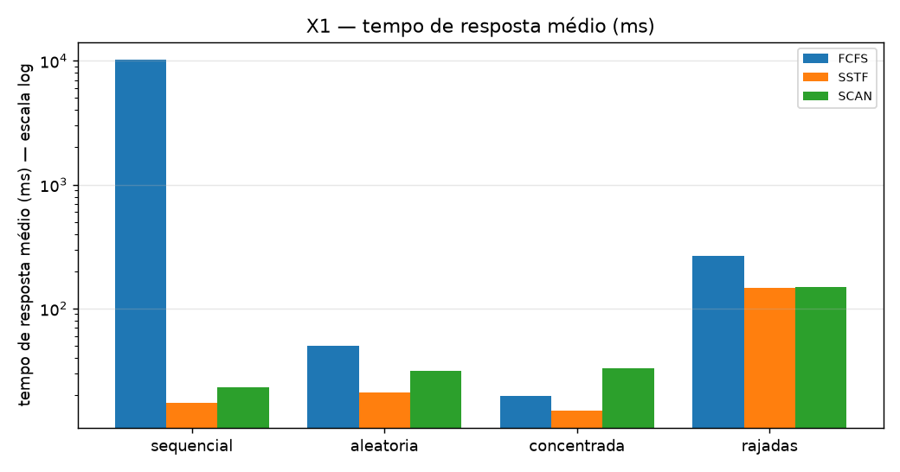
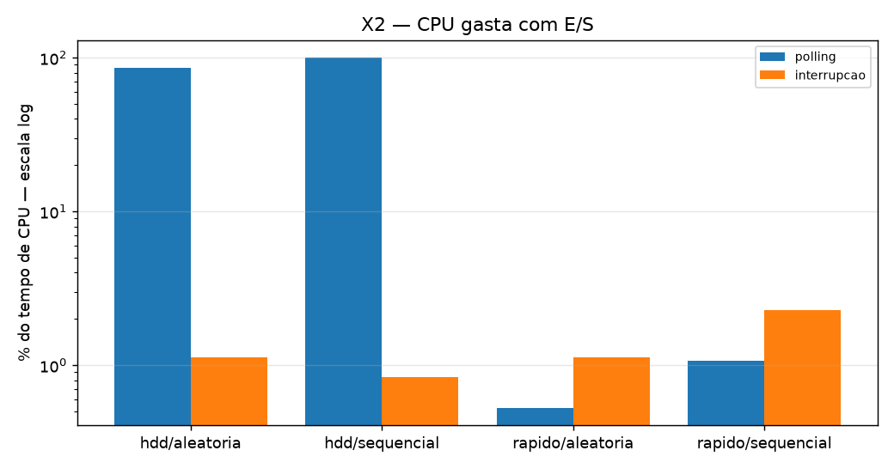
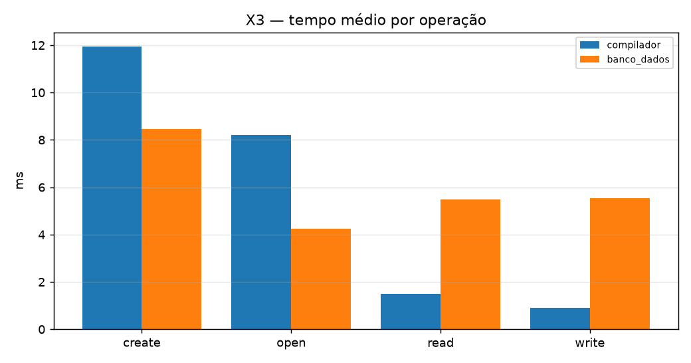
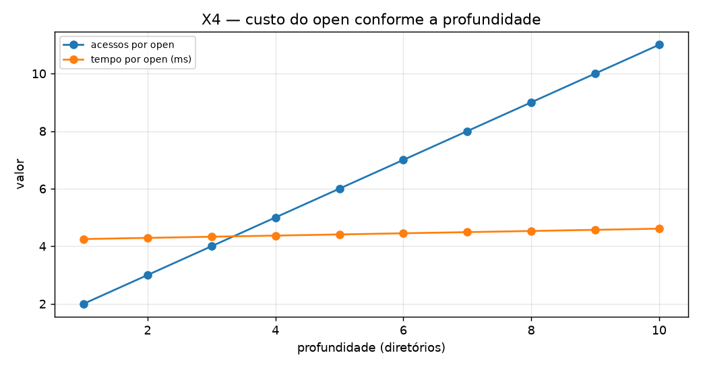
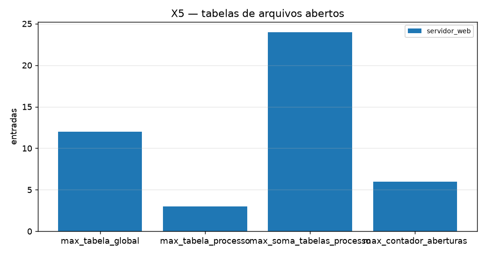
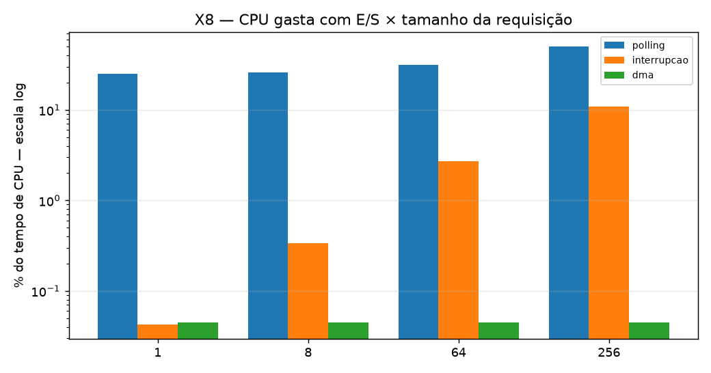
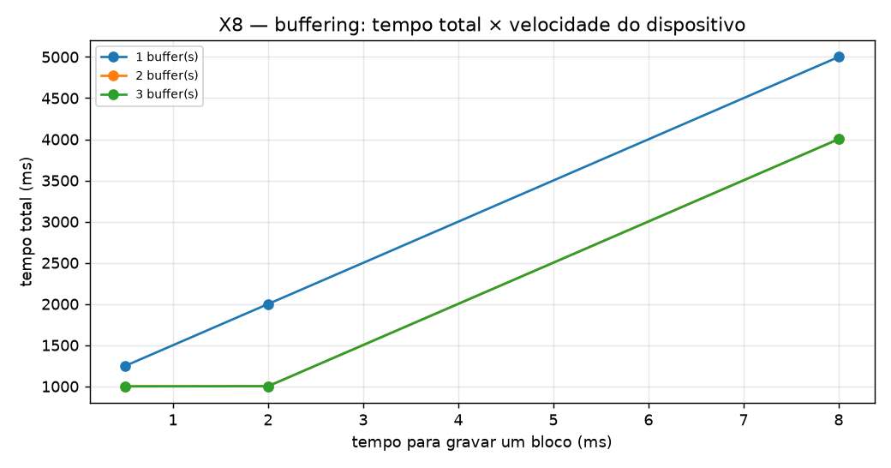

# Relatório — SimES: simulador de E/S e de sistema de arquivos

**Integrantes:** Eduardo Matte Zanardo dos Santos, Henrique Ramos Mayer

**Repositório:** https://github.com/HenriqueMayer/PUCRS-operating-systems/tree/main/Trabalho/T2

## 0. Resumo

O grupo implementou o núcleo do SimES e o módulo M3. O núcleo inclui os escalonadores SSTF e SCAN, o custo de CPU por polling e por interrupção e o sistema de arquivos, com resolução de caminhos, operações e tabelas de arquivos abertos. O M3 inclui o custo de CPU com DMA e o buffering simples, duplo e circular. Os 26 testes automáticos executam sem falhas, com 8 pulados de partes fora do escopo, e os experimentos X1 a X5 e X8 terminam com status `ok`. Os três resultados principais são:

1. No X1, o SSTF reduziu o tempo de resposta médio nas quatro cargas (de 10.241 ms para 17 ms na sequencial), mas o SCAN foi pior que o FCFS na carga concentrada, porque vai até a borda do disco a cada inversão.
2. No X2, o polling ocupou 86% da CPU no disco rígido, contra 1,1% da interrupção, e a relação se inverteu no dispositivo rápido (0,53% contra 1,12%).
3. No X8, o custo de CPU do DMA ficou constante em 0,045%, enquanto o da interrupção chegou a 10,8% com requisições de 256 blocos. O segundo buffer reduziu o tempo total em até 50%, e o terceiro não trouxe ganho.

## 1. Escopo realizado

| Parte | Situação | Observação |
|---|---|---|
| N1 · Dispositivo (fornecido) | usado | — |
| N2 · Subsistema de E/S (SSTF, SCAN, polling, interrupção) | completo | Os 5 testes de `TesteEscalonadores` e `TesteCPU` passam. |
| N3 · Sistema de arquivos | completo | Os 8 testes de `TesteSistemaArquivos` passam. |
| N4 · Experimentos X1–X5 e relatório | completo | X1 a X5 com status `ok` em `resultados/experimentos.csv`. |
| M3 · DMA e buffering | completo | Os 2 testes de `TesteM3DMAeBuffering` passam; X8 com status `ok`. |
| Integração (grupos de 4) | não se aplica | Grupo de 2 integrantes. |
| Bônus flash | não feito | — |

Resultado dos testes automáticos (`python3 executar.py testes`): `Ran 26 tests in 0.003s` — `OK (skipped=8)`. Os 8 testes pulados pertencem aos módulos M1, M2, M4, M5 e M6 e à integração, que estão fora do escopo do grupo.

## 2. Implementação

### N2 — Subsistema de E/S

**Onde:** `simes/es/escalonadores.py`: classes `SSTF` e `SCAN` e funções auxiliares `_mais_proximo`, `_direcao_para` e `_a_frente`. `simes/es/cpu.py`: função `custo_cpu`, ramos `polling` e `interrupcao`.

**Decisões:**

- **SSTF.** `_mais_proximo` percorre a fila e devolve o índice da requisição com a menor distância `|cilindro − cabeça|`. A comparação é estrita (`<`), então, em caso de empate, vence a requisição que está antes na fila, como exige a regra comum do arquivo. A direção devolvida é a do movimento feito; se o alvo está no cilindro da cabeça, a direção atual é mantida.
- **SCAN.** `_a_frente` seleciona as requisições que estão na direção atual do braço; uma requisição no cilindro da cabeça conta como "à frente" nas duas direções. Se há requisições à frente, o SCAN atende a mais próxima delas e mantém a direção. Se não há, o braço vai até a borda do disco (cilindro 0 ou `max_cilindro`), inverte a direção e atende a requisição mais próxima da borda. A borda entra em `passar_por`, para que o simulador some esse deslocamento e o tempo de busca correspondente.
- **Polling.** O custo de CPU é a duração do atendimento, porque a CPU fica em espera ocupada durante toda a requisição.
- **Interrupção.** O custo é `n_blocos × (CUSTO_INTERRUPCAO_MS + CUSTO_COPIA_MS_POR_BLOCO)`: uma interrupção e uma cópia por bloco transferido. As constantes vêm de `parametros.py`; nenhum valor foi repetido no código.

**Dificuldades:** O integrante que implementou esta parte não registrou dificuldades. Os pontos das regras que exigem mais cuidado, e que o código trata de forma explícita, são o desempate pela ordem de chegada, a regra de que uma requisição no cilindro da cabeça conta como "à frente" nas duas direções e a inclusão da borda em `passar_por`. Os testes conferem a ordem de atendimento e o deslocamento total com a fila do livro: 236 cilindros no SSTF, 236 no SCAN descendo e 331 no SCAN subindo.

### N3 — Sistema de arquivos

**Onde:** `simes/arquivos/sistema.py`: métodos `_resolver_pai`, `resolver`, `mkdir`, `create`, `open`, `read`, `write`, `seek`, `close` e `unlink`.

**Decisões:**

- **Resolução de caminhos.** `_resolver_pai` percorre os componentes a partir da raiz e lê o bloco de cada diretório do caminho até o diretório pai, inclusive (1 leitura por diretório). `resolver` usa esse percurso e depois só consulta as entradas do pai, já lido. Assim, `resolver("/a/b/c")` faz as 3 leituras da regra de custo, e `resolver("/")` devolve a raiz sem leitura. Um componente ausente gera `ENOENT`; um componente intermediário que não é diretório gera `ENOTDIR`; um caminho relativo gera `EINVAL`.
- **`mkdir` e `create`.** As duas operações usam `_resolver_pai`, de modo que o custo de leitura é igual ao de `resolver`. O nome repetido gera `EEXIST`. Se o alocador falha por falta de espaço, o FCB recém-criado é removido de `self.fcbs`, para não ficar um FCB sem entrada de diretório. `mkdir` grava o bloco do novo diretório e o bloco do pai (2 escritas). `create` reserva `ceil(tamanho / TAMANHO_BLOCO)` blocos sem gravá-los e grava só o bloco do pai (1 escrita).
- **Tabelas de arquivos abertos.** `open` cria uma `EntradaProcesso` (posição 0 e modo) na tabela do processo e cria ou reutiliza a `EntradaGlobal` do arquivo, cujo contador soma as aberturas de todos os processos. `open` recusa diretórios (`EISDIR`), modos inválidos e handles já em uso no processo (`EINVAL`), e chama o gancho `_verificar_permissao`. `close` remove a entrada do processo, decrementa o contador e remove a entrada global quando ele chega a zero.
- **Leitura.** `read` exige `r` no modo do handle (`EBADF` caso contrário), limita o intervalo ao tamanho do arquivo, lê somente os blocos que contêm os bytes `[posição, fim)` e avança a posição. No fim do arquivo, devolve 0 sem acessar o disco.
- **Escrita.** `write` exige o modo `w`, `rw` ou `a`. No modo `a`, a posição volta para o fim do arquivo antes de cada escrita. O arquivo é estendido pelo alocador só com os blocos que faltam para cobrir o intervalo; depois os blocos do intervalo são gravados, o tamanho é atualizado e o FCB é marcado como sujo. `close` grava o bloco do diretório pai (1 escrita) somente quando o FCB está sujo.
- **`unlink` com arquivo aberto.** `unlink` remove a entrada do diretório, decrementa `links` e grava o bloco do pai. Os blocos só são liberados se `links == 0` e o arquivo não está na tabela global. Se ele ainda está aberto, a liberação fica para o `close` que zera o contador de aberturas.

**Dificuldades:** O integrante que implementou esta parte não registrou dificuldades. O ponto que exige mais cuidado é seguir as regras de custo em todas as operações, porque os testes contam as leituras e as escritas de cada uma. A solução foi concentrar a leitura dos diretórios em `_resolver_pai`, usado por `resolver`, `mkdir`, `create` e `unlink`. Os outros dois pontos tratados de forma explícita são a remoção do FCB quando a alocação falha e a ordem das verificações no `close`, que só libera os blocos depois de remover a entrada global.

### M3 — DMA e buffering

**Onde:** `simes/es/cpu.py`: função `custo_cpu`, ramo `dma`. `simes/es/buffering.py`: função `simular_buffering`.

**Decisões:**

- **DMA.** O custo de CPU por requisição é `CUSTO_PROGRAMAR_DMA_MS + CUSTO_INTERRUPCAO_MS`. Ele não depende do número de blocos nem da duração do atendimento, porque a controladora de DMA copia os blocos e gera uma única interrupção no fim.
- **Buffering.** A simulação é uma recorrência sobre dois vetores: `fim_prod[k]`, o instante em que o produtor termina o bloco k, e `fim_grav[k]`, o instante em que o dispositivo termina de gravá-lo. O produtor começa o bloco k em `max(fim_prod[k−1], fim_grav[k−n_buffers])`; para os primeiros `n_buffers` blocos, o segundo termo é 0, porque todos os buffers estão livres. A diferença entre esse início e `fim_prod[k−1]` é o tempo em que o produtor ficou bloqueado. O dispositivo começa o bloco k em `max(fim_prod[k], fim_grav[k−1])`. O tempo total é `fim_grav[blocos]`, e a utilização é `100 × blocos × consumo_ms ÷ tempo total`.
- **Sem fila de eventos.** A recorrência basta porque o produtor e o dispositivo tratam os blocos em ordem e cada buffer guarda um bloco; o estado de cada bloco depende só do bloco anterior e do bloco `k − n_buffers`.

**Dificuldades:** O integrante que implementou esta parte não registrou dificuldades. O ponto que exige mais cuidado é a regra de liberação do buffer: ele só fica livre quando a gravação do bloco termina, não quando ela começa. Com 1 buffer, isso impede a sobreposição entre produção e gravação, e o teste confere esse caso (100 blocos em 100 × (2,0 + 8,0) ms).

## 3. Experimentos

### X1 — Escalonadores sob quatro padrões de carga

**Hipótese:** O FCFS deve ter o maior deslocamento do braço e o maior tempo de resposta médio nas quatro cargas. O SSTF deve ter o menor deslocamento, e o SCAN deve ficar próximo dele, com um deslocamento um pouco maior por ir até a borda do disco antes de inverter. A diferença em relação ao FCFS deve ser maior na carga sequencial e na carga em rajadas. Na sequencial, o FCFS alterna entre duas regiões distantes a cada requisição: cada atendimento deve custar cerca de 16 ms, contra um intervalo médio de 6 ms entre chegadas, e a fila deve crescer durante toda a execução. Nas rajadas, a fila chega a 50 requisições e há muito o que reordenar; ainda assim, a redução do tempo de resposta deve ser proporcionalmente menor que a do deslocamento, porque a latência rotacional de 4,17 ms por requisição não depende do escalonador. A diferença deve ser menor na carga concentrada, em que o braço já se move pouco e a fila é curta. A maior espera do SSTF deve superar a do SCAN, sobretudo na carga concentrada, porque o SSTF adia as requisições distantes da região mais acessada.

**Fundamentação:** O FCFS atende na ordem de chegada e não aproveita a posição do braço; no exemplo do livro, ele percorre 640 cilindros, contra 236 do SSTF (Silberschatz, 10.4.1 e 10.4.2). O SSTF escolhe sempre a requisição mais próxima e, como o escalonamento SJF, pode causar inanição das requisições distantes (10.4.2). O SCAN percorre o disco de uma borda à outra, o que limita a espera de qualquer requisição (10.4.3). O livro afirma também que o desempenho depende do número e do tipo das requisições: com uma única requisição pendente, todos os algoritmos se comportam como o FCFS (10.4.6). No modelo, o tempo de atendimento é a soma da busca (1,0 ms mais 0,003 ms por cilindro), da latência rotacional (4,17 ms, ou zero se o bloco é o seguinte ao último transferido) e da transferência (0,04 ms por bloco); o escalonador só altera a busca.

**Configuração:** Simulador de E/S por eventos, disco rígido do modelo (5.000 cilindros, 64 blocos por cilindro, braço inicialmente no cilindro 0 e na direção crescente) e conclusão por interrupção. Variam o escalonador (FCFS, SSTF, SCAN) e a carga, num total de 12 execuções. Cada carga tem 2.000 requisições de 8 blocos:

- `cargas/es_sequencial.txt`: dois processos alternados, cada um avançando 8 blocos por requisição em uma região distante da outra (P1 lê a partir do bloco 20.000; P2 escreve a partir do bloco 250.000); intervalo médio entre chegadas de 6 ms.
- `cargas/es_aleatoria.txt`: blocos sorteados em todo o disco; intervalo médio de 12 ms.
- `cargas/es_concentrada.txt`: 80% das requisições nos primeiros 20% do disco (cilindros 0 a 999) e 20% em todo o disco; intervalo médio de 12 ms.
- `cargas/es_rajadas.txt`: 40 rajadas de 50 requisições que chegam no mesmo instante, uma rajada a cada 600 ms, com blocos sorteados em todo o disco.

Nas três últimas cargas, 70% das requisições são leituras. Medem-se o deslocamento total do braço (cilindros), o tempo de resposta médio e no percentil 95 (ms), a maior espera na fila (ms) e a vazão (requisições/s).

**Resultados:** A tabela reúne os indicadores das 12 execuções. Em relação ao FCFS, o SSTF reduziu o deslocamento em 67,5% (sequencial), 20,6% (aleatória), 13,5% (concentrada) e 93,7% (rajadas), e o tempo de resposta médio em 99,8%, 58,1%, 24,1% e 44,8%. O SCAN aumentou o deslocamento em 1,7% na carga aleatória e em 79,1% na concentrada. O gráfico usa escala logarítmica.

| Carga | Escalonador | Deslocamento (cilindros) | Resposta média (ms) | Resposta p95 (ms) | Maior espera (ms) | Vazão (req/s) |
|---|---|---:|---:|---:|---:|---:|
| sequencial | FCFS | 7.184.093 | 10.241,05 | 19.565,45 | 20.598,06 | 61,48 |
| sequencial | SSTF | 2.336.365 | 17,39 | 32,79 | 37,44 | 167,49 |
| sequencial | SCAN | 2.469.069 | 23,21 | 43,65 | 48,59 | 167,41 |
| aleatória | FCFS | 3.316.472 | 50,10 | 145,09 | 193,52 | 82,45 |
| aleatória | SSTF | 2.631.714 | 20,99 | 48,61 | 116,65 | 82,45 |
| aleatória | SCAN | 3.372.680 | 31,53 | 65,06 | 116,73 | 82,36 |
| concentrada | FCFS | 1.864.164 | 19,80 | 48,57 | 96,02 | 83,81 |
| concentrada | SSTF | 1.613.030 | 15,02 | 37,20 | 130,52 | 83,81 |
| concentrada | SCAN | 3.338.708 | 33,20 | 68,33 | 118,75 | 83,70 |
| em rajadas | FCFS | 3.341.490 | 266,97 | 505,32 | 597,29 | 83,46 |
| em rajadas | SSTF | 209.811 | 147,49 | 277,72 | 296,99 | 84,42 |
| em rajadas | SCAN | 199.955 | 148,62 | 278,70 | 285,44 | 84,43 |

**Evidências:** `resultados/es.csv` (linhas com `experimento=X1`); `graficos/X1_resposta_media_ms.png`; `graficos/X1_deslocamento_total.png`; `graficos/X1_espera_max_ms.png`.

**Análise:** O SSTF teve o menor tempo de resposta médio nas quatro cargas e o menor deslocamento em três delas; nas rajadas, o SCAN percorreu 4,7% menos. As maiores diferenças em relação ao FCFS apareceram onde a hipótese previa, na carga sequencial e nas rajadas.

Na carga sequencial, cada atendimento do FCFS custou 16,27 ms (32.533 ms para 2.000 requisições) e percorreu 3.592 cilindros, a distância entre as duas regiões. O valor é o do modelo: 1,0 + 3.592 × 0,003 = 11,78 ms de busca, 4,17 ms de rotação e 0,32 ms de transferência. Como as requisições chegam a cada 6 ms, o disco não acompanha as chegadas: a vazão ficou em 61,48 req/s para uma taxa de chegada de 166,7 req/s, e a maior espera foi de 20,6 s. O SSTF e o SCAN atendem primeiro as requisições da região em que o braço está, que são sequenciais e custam só a transferência (0,32 ms), e só depois cruzam o disco. Com eles a vazão subiu para 167 req/s, igual à taxa de chegada.

Nas rajadas, 50 requisições chegam juntas e há o que reordenar: o SCAN percorreu 4.999 cilindros por rajada, uma varredura do disco, contra 83.537 do FCFS. A queda de 94% no deslocamento virou uma queda de 45% no tempo de resposta. O motivo é o piso do modelo: cada atendimento paga 1,0 ms de busca mínima, 4,17 ms de rotação e 0,32 ms de transferência, um total de 5,49 ms que nenhum escalonador elimina.

Na carga aleatória, o FCFS percorreu 1.658 cilindros por requisição, um terço do disco, como se espera da distância entre dois cilindros sorteados. O SSTF reduziu o deslocamento em só 20,6% porque a fila é curta. Pela fórmula de Little (n = λ × W; Silberschatz, 6.8.2), há em média 1,7 requisição no sistema com o SSTF, e com uma única requisição pendente qualquer algoritmo se comporta como o FCFS (10.4.6). Mesmo assim, o tempo de resposta caiu 58,1%, mais que o deslocamento. No FCFS, o disco fica ocupado 86,3% do tempo (valor de `cpu_es_pct` com polling no X2, que no modelo é igual à ocupação do disco); perto da saturação, uma redução pequena no tempo de atendimento esvazia a fila.

Dois resultados contrariaram a hipótese. O primeiro é que o SCAN não ficou próximo do SSTF nas cargas aleatória e concentrada: percorreu 28,2% e 107,0% mais cilindros, e na concentrada foi pior que o FCFS em deslocamento (79,1% a mais) e em tempo de resposta (33,20 ms contra 19,80 ms). O SCAN implementado é o da definição: quando não há requisição à frente, o braço vai até a borda antes de inverter. Com 80% das requisições nos cilindros 0 a 999 e fila curta, o braço que sobe e não encontra nada à frente vai até o cilindro 4.999 e volta. São até 8.000 cilindros e cerca de 26 ms de busca numa única inversão, mais que dois intervalos entre chegadas. O LOOK, que inverte na última requisição (10.4.5), evitaria esse percurso; ele pertence ao módulo M2, fora do escopo do grupo. Na carga aleatória, o SCAN percorreu mais que o FCFS e ainda assim respondeu 37,1% mais rápido: o percurso extra acontece quando a fila está quase vazia, e, quando a fila cresce, uma varredura atende várias requisições.

O segundo é que a maior espera do SSTF só superou a do SCAN em duas cargas: na concentrada (130,52 ms contra 118,75 ms) e nas rajadas (296,99 ms contra 285,44 ms). Na concentrada, o SSTF teve a menor resposta média e a maior espera das três políticas, acima até da do FCFS (96,02 ms). É a inanição descrita no livro: as requisições distantes da região mais acessada são adiadas (10.4.2). Na carga aleatória, as duas esperas ficaram iguais (116,65 ms e 116,73 ms). Na sequencial, a do SSTF foi menor (37,44 ms contra 48,59 ms): com só duas regiões, o SSTF esvazia a fila de uma e é obrigado a ir para a outra, sem requisição intermediária que adie a mais distante.

**Veredito:** PARCIALMENTE CONFIRMADA

### X2 — Polling × interrupção conforme o dispositivo

**Hipótese:** No disco rígido, o polling deve gastar muito mais CPU que a interrupção: acima de 80% do tempo, contra cerca de 1%. A CPU fica em espera ocupada durante a busca e a rotação, que duram milissegundos, enquanto as 8 interrupções e cópias de uma requisição somam 0,136 ms. No dispositivo rápido, a relação deve se inverter: atender 8 blocos leva 8 × 0,008 = 0,064 ms, menos que os 0,136 ms da interrupção, e o polling deve gastar cerca de metade da CPU que a interrupção gasta. No disco rígido, a carga sequencial deve aumentar o custo do polling, porque o FCFS alterna entre duas regiões distantes e o disco fica ocupado quase o tempo todo.

**Fundamentação:** O polling é eficiente quando o dispositivo responde rápido: bastam cerca de três instruções para consultar o registrador de estado. Ele se torna ineficiente quando a CPU consulta muitas vezes um dispositivo que raramente está pronto (Silberschatz, 13.2.1). A interrupção libera a CPU durante a espera, mas cada interrupção tem o custo de salvar o estado, executar o tratador e restaurar o estado (13.2.2). Por isso o livro afirma que a E/S programada pode ser mais eficiente que a E/S por interrupção quando a espera ocupada é curta (13.7). No modelo, o custo do polling é a duração do atendimento, e o da interrupção é de 0,017 ms por bloco (0,015 ms da interrupção mais 0,002 ms da cópia).

**Configuração:** Escalonador FCFS em todas as execuções. Variam o dispositivo, a carga e o modo de conclusão, num total de 8 execuções. Os dispositivos são o disco rígido do modelo e o dispositivo rápido, que não tem busca nem latência rotacional e transfere um bloco em 0,008 ms. As cargas são a aleatória e a sequencial do X1 (2.000 requisições de 8 blocos). O custo de CPU por requisição é a duração do atendimento no polling e `8 × (0,015 + 0,002) = 0,136 ms` na interrupção. Mede-se a porcentagem do tempo total da simulação em que a CPU ficou ocupada com E/S (`cpu_es_pct`).

**Resultados:** A tabela mostra a porcentagem do tempo da simulação em que a CPU ficou ocupada com E/S, nas 8 execuções. No disco rígido com carga aleatória, o polling gastou 77 vezes mais CPU que a interrupção (86,28% contra 1,12%). No dispositivo rápido, o polling gastou 0,47 vez o que a interrupção gastou, nas duas cargas.

| Dispositivo | Carga | CPU com polling (%) | CPU com interrupção (%) | Tempo total (ms) |
|---|---|---:|---:|---:|
| disco rígido | aleatória | 86,2832 | 1,1213 | 24.256,65 |
| disco rígido | sequencial | 99,9977 | 0,8361 | 32.533,04 |
| rápido | aleatória | 0,5280 | 1,1219 | 24.244,38 |
| rápido | sequencial | 1,0739 | 2,2821 | 11.918,78 |

**Evidências:** `resultados/es.csv` (linhas com `experimento=X2`); `graficos/X2_cpu.png`.

**Análise:** Os quatro valores da interrupção vêm do mesmo custo de CPU: 2.000 requisições × 0,136 ms = 272 ms. A porcentagem muda só porque o tempo total muda: 272 ms em 24.257 ms dão 1,12%; em 32.533 ms, 0,84%; em 11.919 ms, 2,28%. No polling, o custo é a soma das durações dos atendimentos, e a porcentagem é a ocupação do dispositivo. No disco rígido com carga aleatória, a CPU ficou 20.929 ms em espera ocupada (86,28% de 24.257 ms). Com carga sequencial, o disco está saturado (ver X1), e o polling ocupou 99,998% da CPU. No dispositivo rápido, atender 8 blocos leva 0,064 ms: o polling custou 128 ms no total, e a razão entre os dois modos é 0,064 / 0,136 = 0,47, a mesma nas duas cargas.

O resultado segue a regra do livro: o polling compensa quando a espera ocupada é mais curta que o tratamento da interrupção (13.2.1 e 13.7). No modelo, o ponto de equilíbrio para 8 blocos é um atendimento de 0,136 ms. O acesso não sequencial mais rápido do disco rígido dura 4,49 ms (rotação mais transferência), 33 vezes esse limite; a interrupção vence em qualquer acesso mecânico. O tempo de resposta foi igual nos dois modos em todas as execuções (50,10 ms na carga aleatória do disco rígido), porque no modelo o custo de CPU não atrasa a E/S. Num sistema real, a CPU presa no polling deixaria de executar outros processos.

**Veredito:** CONFIRMADA

### X3 — Acesso sequencial × direto

**Hipótese:** O número de acessos por `read` deve ser praticamente o mesmo nas duas cargas: cada leitura de até 4.096 bytes acessa 1 bloco. O tempo por `read` deve ser muito maior no banco de dados: cada leitura em posição sorteada paga busca e latência rotacional (cerca de 5 ms), enquanto no compilador a maioria das leituras pede o bloco seguinte ao anterior e paga só a transferência (0,04 ms). No total por operação, o compilador deve ter mais acessos, porque abre centenas de arquivos e cada `open` lê os 3 diretórios do caminho; o banco de dados abre a tabela uma única vez, e os seus `seek` não acessam o disco. Por isso, o tempo médio por operação deve ficar na mesma ordem de grandeza nas duas cargas (poucos milissegundos): no compilador, o custo deve se concentrar em `open`, `create` e `close`; no banco de dados, em `read` e `write`.

**Fundamentação:** No acesso sequencial, a informação é processada em ordem, um registro após o outro, como fazem os compiladores e os editores. No acesso direto, o arquivo é uma sequência numerada de blocos que podem ser lidos em qualquer ordem, como exigem os bancos de dados (Silberschatz, 11.2.1 e 11.2.2). A alocação contígua atende aos dois métodos: o bloco i do arquivo está no endereço inicial mais i, sem acesso extra (12.4.1). A diferença aparece no dispositivo, porque o tempo de posicionamento de um disco é a soma do tempo de busca e da latência rotacional (10.1.1). No modelo, um bloco que é o seguinte ao último transferido não paga busca nem latência rotacional; qualquer outro paga 4,17 ms de rotação e, se muda de cilindro, pelo menos 1,0 ms de busca.

**Configuração:** Sistema de arquivos com alocação contígua sobre o disco rígido do modelo. A camada de blocos executa os acessos em ordem, sem fila nem escalonador. Comparam-se duas cargas:

- `cargas/fs_compilador.txt` (3.904 operações): 40 arquivos-fonte de 2 a 64 KiB e 15 cabeçalhos de 1 a 8 KiB. Em cada uma de 3 compilações, cada fonte e 3 cabeçalhos são lidos do início ao fim em pedaços de 4.096 bytes, e um arquivo-objeto é criado e gravado em pedaços de até 4.096 bytes.
- `cargas/fs_banco_dados.txt` (6.602 operações): uma tabela de 64 MiB aberta uma única vez. Cada uma de 3.000 transações faz `seek` para uma posição sorteada, múltipla de 4.096; em 80% delas lê 4.096 bytes, e nas demais grava 4.096 bytes na tabela e acrescenta 512 bytes a um arquivo de log.

Medem-se os acessos por operação (1 acesso = 1 bloco lido ou gravado) e o tempo de disco por operação (ms), no total e por tipo de operação.

**Resultados:** As tabelas mostram os totais de cada carga e o detalhe por operação. O `read` fez 1,00 acesso por execução nas duas cargas, mas levou 5,49 ms no banco de dados e 1,48 ms no compilador. O tempo médio por operação ficou em 3,07 ms e 3,01 ms.

| Carga | Operações | Acessos | Acessos por operação | Tempo total (ms) | Tempo por operação (ms) |
|---|---:|---:|---:|---:|---:|
| compilador | 3.904 | 5.400 | 1,38 | 11.986,65 | 3,07 |
| banco de dados | 6.602 | 3.610 | 0,55 | 19.846,96 | 3,01 |

| Carga | Operação | Execuções | Acessos por execução | Tempo por execução (ms) | Parcela do tempo total (%) |
|---|---|---:|---:|---:|---:|
| compilador | `open` | 600 | 3,00 | 8,20 | 41,1 |
| compilador | `read` | 1.719 | 1,00 | 1,48 | 21,3 |
| compilador | `create` | 175 | 4,00 | 11,95 | 17,4 |
| compilador | `unlink` | 80 | 4,00 | 13,69 | 9,1 |
| compilador | `write` | 726 | 1,00 | 0,91 | 5,5 |
| compilador | `close` | 600 | 0,20 | 1,05 | 5,2 |
| compilador | `mkdir` | 4 | 3,75 | 10,58 | 0,4 |
| banco de dados | `read` | 2.405 | 1,00 | 5,49 | 66,5 |
| banco de dados | `write` | 1.190 | 1,00 | 5,54 | 33,2 |
| banco de dados | `seek` | 3.000 | 0,00 | 0,00 | 0,0 |
| banco de dados | `open`, `close`, `create`, `mkdir` | 7 | 1,00 a 3,00 | 4,25 a 8,46 | 0,2 |

**Evidências:** `resultados/arquivos.csv` e `resultados/arquivos_por_operacao.csv` (linhas com `experimento=X3`); `graficos/X3_tempo_por_operacao.png`.

**Análise:** A quantidade de acessos não distingue os dois métodos: uma leitura de 4.096 bytes acessa 1 bloco em qualquer posição, e a alocação contígua não exige acesso extra para localizar o bloco (12.4.1). A diferença está no tempo de cada acesso. No banco de dados, toda leitura vem depois de um `seek` para uma posição sorteada e paga 4,17 ms de rotação, 0,04 ms de transferência e, em média, 1,28 ms de busca dentro dos 256 cilindros da tabela. No compilador, o custo depende de a leitura ser ou não a primeira do arquivo. As 1.719 leituras se dividem em 480 primeiras leituras, uma por arquivo aberto para leitura, que pagam busca e rotação e custam cerca de 5,2 ms, e 1.239 leituras do bloco seguinte, que custam 0,04 ms. A média de 1,48 ms resulta dessa mistura: 72% das leituras do compilador custam 137 vezes menos que uma leitura do banco de dados.

O tempo médio por operação quase igual (3,07 ms e 3,01 ms) esconde composições opostas. No compilador, as operações de diretório (`open`, `create`, `unlink`, `close` e `mkdir`) somam 73,2% do tempo, e `read` e `write`, 26,8%: a carga abre 600 arquivos, e cada `open` lê os 3 diretórios do caminho (3,00 acessos e 8,20 ms). No banco de dados, `read` e `write` somam 99,8% do tempo; a tabela é aberta uma vez, e os 3.000 `seek` não acessam o disco, o que explica o valor de 0,55 acesso por operação. Com arquivos pequenos, chegar ao arquivo custa mais que ler o conteúdo; com um arquivo grande e acesso direto, o custo é o posicionamento a cada bloco.

**Veredito:** CONFIRMADA

### X4 — Custo de resolver caminhos conforme a profundidade

**Hipótese:** O número de acessos do `open` deve crescer linearmente com a profundidade: d + 1 leituras para um arquivo a d diretórios da raiz (a raiz e os d diretórios do caminho), ou seja, de 2 acessos na profundidade 1 a 11 na profundidade 10. O tempo do `open` também deve crescer com a profundidade, mas bem menos que proporcionalmente. Os diretórios são criados em sequência num disco vazio, e a alocação contígua com primeiro encaixe deve colocá-los em blocos vizinhos. Pelo modelo, só a primeira leitura pagaria a latência rotacional (4,17 ms), e cada diretório seguinte custaria a transferência de um bloco (0,04 ms).

**Fundamentação:** Num diretório em árvore, um caminho absoluto é resolvido da raiz até o arquivo, um componente por vez (Silberschatz, 11.3). Para abrir um arquivo, o sistema percorre a estrutura de diretórios à procura do nome; por isso os sistemas reais mantêm partes dessa estrutura em cache na memória (12.2.1). O simulador não tem essa cache: a regra de custo de `resolver` cobra 1 leitura de bloco por diretório do caminho, inclusive a raiz. O tempo de cada leitura segue o modelo do disco, que não cobra latência rotacional quando o bloco lido é o seguinte ao último transferido.

**Configuração:** Para cada profundidade d de 1 a 10, cria-se uma cadeia de d diretórios (`/n1/n2/.../nd`) com um arquivo de 4.096 bytes no fim. Depois, um segundo processo repete 20 vezes a sequência `open`, `read` de 4.096 bytes e `close`. São 10 execuções, com alocação contígua e o disco rígido do modelo. Medem-se os acessos médios e o tempo médio de disco do `open` (ms) em cada profundidade.

**Resultados:** O número de acessos do `open` foi exatamente d + 1 em todas as profundidades. O tempo passou de 4,25 ms na profundidade 1 para 4,61 ms na profundidade 10: os acessos cresceram 5,5 vezes, e o tempo, 8,5%.

| Profundidade (diretórios) | Acessos por `open` | Tempo por `open` (ms) |
|---:|---:|---:|
| 1 | 2 | 4,25 |
| 2 | 3 | 4,29 |
| 3 | 4 | 4,33 |
| 4 | 5 | 4,37 |
| 5 | 6 | 4,41 |
| 6 | 7 | 4,45 |
| 7 | 8 | 4,49 |
| 8 | 9 | 4,53 |
| 9 | 10 | 4,57 |
| 10 | 11 | 4,61 |

**Evidências:** `resultados/arquivos_por_operacao.csv` (linhas com `experimento=X4` e `operacao=open`); `graficos/X4_open_por_profundidade.png`.

**Análise:** Os acessos seguem a regra de custo de `resolver`: uma leitura para a raiz e uma para cada diretório do caminho. O tempo segue a expressão 4,17 + 0,04 × (d + 1) ms, que reproduz os dez valores medidos. Cada diretório acrescenta só 0,04 ms porque o alocador contíguo, com primeiro encaixe num disco vazio, coloca a raiz e os d diretórios nos blocos 0 a d, todos no cilindro 0, e `resolver` os lê nessa ordem. Não há busca, e só a primeira leitura paga a latência rotacional; as demais leem o bloco seguinte ao último transferido. Pelo mesmo motivo, o `read` que vem depois do `open` custou 0,04 ms: o arquivo ocupa o bloco d + 1.

O experimento mede, portanto, o melhor caso de localidade: um disco recém-formatado, em que a ordem de criação coincide com a ordem de leitura. Pelo modelo, se cada diretório estivesse num cilindro diferente, cada nível custaria pelo menos 1,0 + 4,17 + 0,04 = 5,21 ms, e o `open` na profundidade 10 levaria cerca de 57 ms, 12 vezes o valor medido. Esse segundo número é uma conta com os parâmetros, não uma medição. O custo de resolver um caminho depende menos do número de componentes que da posição dos diretórios no disco, e isso explica por que os sistemas reais guardam as entradas de diretório em memória (12.2.1).

**Veredito:** CONFIRMADA

### X5 — Tabelas de arquivos abertos com vários processos

**Hipótese:** A tabela de um processo deve chegar a 3 entradas, e a soma das tabelas dos 8 processos, a 24, porque cada abertura cria uma entrada própria, com a sua posição e o seu modo. A tabela global deve ficar bem menor: no máximo 12 entradas, uma por página, mesmo com 24 aberturas simultâneas. O contador de aberturas de uma entrada global deve passar de 1 sempre que dois processos abrem a mesma página. Como cada processo sorteia 3 das 12 páginas, o maior contador deve ficar entre 5 e 7, com limite teórico de 8.

**Fundamentação:** O sistema operacional mantém duas tabelas de arquivos abertos. A tabela por processo guarda o que é próprio de cada abertura, como o ponteiro de posição e o modo de acesso. A tabela global guarda o que não depende do processo, como a localização do arquivo no disco e o tamanho, além de um contador de aberturas que indica quantos processos têm o arquivo aberto. Cada `close` decrementa o contador, e a entrada global é removida quando ele chega a zero (Silberschatz, 11.1.2 e 12.2.1). Assim, o número de entradas globais é limitado pelo número de arquivos distintos, e o de entradas por processo cresce com o número de aberturas.

**Configuração:** Carga `cargas/fs_servidor_web.txt` (6.279 operações), em uma execução. Um processo cria 12 páginas de 8 a 96 KiB em `/www`. Em cada uma de 40 rodadas, 8 processos abrem 3 páginas distintas cada um, sorteadas entre as 12; depois todos leem as suas páginas por inteiro, em pedaços de 16.384 bytes; por fim, todos as fecham. As 24 aberturas de uma rodada acontecem antes de qualquer fechamento. Medem-se os valores máximos, ao longo da execução, do número de entradas da tabela global, do número de entradas da tabela de um processo, da soma das entradas das tabelas de todos os processos e do contador de aberturas de uma entrada global.

**Resultados:** A tabela mostra os valores máximos observados na execução. A carga fez 960 aberturas (40 rodadas × 24); cada `open` custou 2,00 acessos e 4,27 ms, e cada `close`, nenhum acesso.

| Indicador (valor máximo na execução) | Valor |
|---|---:|
| Entradas na tabela global | 12 |
| Entradas na tabela de um processo | 3 |
| Soma das entradas das tabelas de processo | 24 |
| Contador de aberturas de uma entrada global | 6 |

**Evidências:** `resultados/arquivos.csv` e `resultados/arquivos_por_operacao.csv` (linhas com `experimento=X5`); `graficos/X5_tabelas.png`.

**Análise:** Os quatro valores coincidem com a hipótese. As tabelas de processo chegaram a 24 entradas no total porque cada uma das 24 aberturas simultâneas tem a sua entrada, com posição e modo próprios; é isso que permite a vários processos ler a mesma página, cada um no seu ponto. A tabela global parou em 12, o número de páginas distintas: uma abertura repetida do mesmo arquivo reutiliza a entrada existente e só incrementa o contador. No pior momento, 6 dos 8 processos tinham a mesma página aberta, e a entrada dessa página era uma só. Em média, cada entrada global atendia 2 aberturas (24 / 12).

A estrutura em dois níveis evita duplicar os dados que não dependem do processo e dá ao sistema um critério para liberar recursos: a entrada global sai quando o contador chega a zero (11.1.2). O mesmo contador sustenta o `unlink` de arquivo aberto implementado no núcleo, em que os blocos só são liberados no último `close`. O `close` não fez acessos porque a carga só lê: nenhum FCB ficou sujo, e a regra de custo só grava o diretório pai quando os metadados mudaram. O `open` custou 2,00 acessos, a leitura da raiz e a de `/www`.

**Veredito:** CONFIRMADA

### X8 — DMA e buffering (M3)

**Hipótese:** Na parte de CPU, o custo do DMA deve ser constante por requisição (0,018 ms), qualquer que seja o tamanho, e o da interrupção deve crescer linearmente com o número de blocos (0,017 ms por bloco). Com 1 bloco, os dois modos devem ficar praticamente empatados, com o DMA ligeiramente acima; com 256 blocos, a interrupção deve custar cerca de 240 vezes mais que o DMA. O polling deve ter o maior custo em todos os tamanhos, porque ocupa a CPU durante a busca e a rotação, e deve crescer com o tamanho bem menos que a interrupção, porque o tempo mecânico domina o atendimento. Na parte de buffering, o segundo buffer deve reduzir o tempo total, porque permite gerar um bloco enquanto o anterior é gravado: com um buffer, cada bloco custa a soma dos tempos de produção e de gravação; com dois, custa o maior dos dois tempos. O ganho deve ser máximo quando as velocidades são iguais (gravação de 2,0 ms), caso em que o tempo total deve cair para cerca da metade. O terceiro buffer não deve trazer ganho relevante, porque os tempos são constantes e o ritmo é limitado pelo mais lento dos dois. Com o dispositivo de 8,0 ms, o produtor deve ficar bloqueado na maior parte do tempo em qualquer configuração.

**Fundamentação:** Na E/S programada, a CPU vigia os bits de estado e move os dados; na E/S por interrupção, ela é interrompida a cada bloco transferido. O DMA retira esse trabalho da CPU: ela programa a controladora de DMA com a origem, o destino e a contagem, a controladora transfere os dados diretamente entre o dispositivo e a memória, e uma única interrupção avisa o fim (Silberschatz, 13.2.3). Entre os princípios de desempenho do livro estão reduzir o número de interrupções com transferências grandes e aumentar a concorrência com o DMA (13.7). O buffering resolve a diferença de velocidade entre quem produz e quem consome os dados; com dois buffers, o produtor enche um enquanto o outro é gravado, o que desacopla os dois (13.4.2). No modelo, o custo de CPU de uma requisição de n blocos é n × 0,017 ms na interrupção e 0,003 + 0,015 = 0,018 ms no DMA, e um buffer só fica livre quando a gravação do seu bloco termina.

**Configuração:** O experimento tem duas partes.

- **CPU:** escalonador FCFS, disco rígido do modelo e carga aleatória gerada com a semente 11 (1.000 requisições, intervalo médio de 40 ms). Variam o tamanho da requisição (1, 8, 64 e 256 blocos) e o modo de conclusão (polling, interrupção, DMA), num total de 12 execuções. O custo de CPU por requisição de n blocos é a duração do atendimento no polling, `n × 0,017 ms` na interrupção e `0,003 + 0,015 = 0,018 ms` no DMA. Mede-se a porcentagem do tempo total em que a CPU ficou ocupada com E/S (`cpu_es_pct`).
- **Buffering:** um produtor gera 500 blocos, um a cada 2,0 ms, e um dispositivo grava um bloco em 0,5, 2,0 ou 8,0 ms. Para cada velocidade, testam-se 1, 2 e 3 buffers de um bloco (simples, duplo e circular), num total de 9 execuções. Medem-se o tempo total (ms), o tempo em que o produtor ficou bloqueado (ms) e a utilização do dispositivo (%).

**Resultados:** A primeira tabela mostra a CPU gasta com E/S em cada modo (12 execuções), e a segunda, o buffering (9 execuções). O DMA ficou em 0,0448% em todos os tamanhos, e a interrupção foi de 0,0423% com 1 bloco a 10,8204% com 256 blocos. O segundo buffer reduziu o tempo total em 20,0%, 49,9% e 20,0%, conforme a velocidade do dispositivo; o terceiro não o alterou.

| Blocos por requisição | CPU com polling (%) | CPU com interrupção (%) | CPU com DMA (%) | Resposta média (ms) |
|---:|---:|---:|---:|---:|
| 1 | 25,1715 | 0,0423 | 0,0448 | 12,30 |
| 8 | 25,8677 | 0,3383 | 0,0448 | 12,71 |
| 64 | 31,4371 | 2,7059 | 0,0448 | 16,16 |
| 256 | 50,5224 | 10,8204 | 0,0448 | 31,87 |

| Gravação de um bloco (ms) | Buffers | Tempo total (ms) | Bloqueio do produtor (ms) | Utilização do dispositivo (%) |
|---:|---:|---:|---:|---:|
| 0,5 | 1 | 1.250,0 | 249,5 | 20,00 |
| 0,5 | 2 | 1.000,5 | 0,0 | 24,99 |
| 0,5 | 3 | 1.000,5 | 0,0 | 24,99 |
| 2,0 | 1 | 2.000,0 | 998,0 | 50,00 |
| 2,0 | 2 | 1.002,0 | 0,0 | 99,80 |
| 2,0 | 3 | 1.002,0 | 0,0 | 99,80 |
| 8,0 | 1 | 5.000,0 | 3.992,0 | 80,00 |
| 8,0 | 2 | 4.002,0 | 2.988,0 | 99,95 |
| 8,0 | 3 | 4.002,0 | 2.980,0 | 99,95 |

**Evidências:** `resultados/es.csv` (linhas com `experimento=X8`); `resultados/buffering.csv`; `graficos/X8_cpu.png`; `graficos/X8_buffering.png`.

**Análise:** Na parte de CPU, os valores reproduzem as fórmulas do modelo. O tempo total foi de cerca de 40,2 s em todas as execuções, porque é determinado pelas chegadas (1.000 requisições, uma a cada 40 ms, em média). O DMA gastou 1.000 × 0,018 ms = 18 ms de CPU em todos os tamanhos. A interrupção gastou 1.000 × n × 0,017 ms: 17 ms com 1 bloco e 4.352 ms com 256, uma razão de 241,5 para o DMA. Com 1 bloco, o DMA custou 5,9% mais que a interrupção (0,018 ms contra 0,017 ms), porque programar a controladora não compensa para um único bloco; a partir de 2 blocos, o DMA é mais barato. O DMA faz o custo de CPU deixar de depender do tamanho da transferência (13.2.3). O polling teve o maior custo em todos os tamanhos e passou de 25,17% para 50,52%. Esse valor é a ocupação do disco, e só dobrou porque a transferência de 256 blocos (10,24 ms) tem a mesma ordem de grandeza do tempo mecânico de um atendimento.

Na parte de buffering, os tempos seguem duas expressões, em que c é o tempo de gravação de um bloco. Com 1 buffer, o tempo total é 500 × (2,0 + c): o produtor só gera o bloco seguinte quando a gravação do anterior termina, e as duas atividades nunca se sobrepõem. Com 2 buffers, o tempo total é 500 × max(2,0; c) mais uma vez o menor dos dois tempos: a produção e a gravação ocorrem ao mesmo tempo, e o ritmo é o do mais lento. O ganho foi máximo com velocidades iguais (de 2.000,0 ms para 1.002,0 ms), caso em que a utilização do dispositivo subiu de 50,0% para 99,8%.

O terceiro buffer não mudou o tempo total em nenhum caso. Com gravação de 8,0 ms, ele só reduziu o bloqueio do produtor de 2.988 ms para 2.980 ms, o tempo de um bloco gerado antes. Com tempos constantes, um buffer a mais não aumenta a vazão; ele só adianta trabalho do lado mais rápido. Nesse mesmo caso, o produtor ficou bloqueado 79,8% do tempo com 1 buffer e 74,7% com 2: quando o dispositivo é o gargalo, o buffering não elimina a espera.

**Veredito:** CONFIRMADA

## 4. Relação com sistemas reais

**Escalonamento de disco (X1)**

O Linux atual não oferece FCFS, SSTF e SCAN por nome. A camada de blocos (blk-mq) permite escolher, por dispositivo, entre `mq-deadline`, `bfq`, `kyber` e `none`, no arquivo `/sys/block/<dispositivo>/queue/scheduler` (documentação *Switching Scheduler*). O `none` não reordena as requisições e corresponde ao FCFS do simulador. O `mq-deadline` atende lotes de requisições em ordem crescente de setor, como uma varredura, e dá a cada requisição um prazo para o início do atendimento (`read_expire` e `write_expire`); a documentação descreve o objetivo como tentar garantir um tempo de início de serviço. É a resposta ao que o X1 mostrou na carga concentrada, em que o SSTF teve a melhor média e a pior espera máxima. O BFQ segue outro critério: divide o dispositivo entre os processos em proporção a pesos e privilegia a latência das aplicações interativas. Segundo a documentação, ele custa mais CPU por requisição (1,9 µs contra 0,7 µs do mq-deadline, no processador citado). O SimES não mede a justiça entre processos e, por isso, não reproduz essa vantagem.

A documentação do blk-mq registra que os SSDs e os dispositivos NVMe não têm partes mecânicas nem penalidade de acesso aleatório, e que com eles o gargalo passou do dispositivo para o sistema operacional. É o caso do dispositivo rápido do X2: sem busca, não há deslocamento a economizar. Em Windows, Linux e macOS, os discos atuais também reordenam os comandos na própria controladora, e o sistema operacional não conhece a posição física dos blocos (Silberschatz, 10.4.6). Isso reduz o ganho de um escalonador como os do X1.

**Polling, interrupção e DMA (X2 e X8)**

A inversão observada no X2 corresponde ao que o Linux faz na rede com o NAPI. O dispositivo gera uma interrupção, o driver mantém as interrupções mascaradas, e o kernel consulta o dispositivo até acabar o trabalho pendente; só então as interrupções são reativadas. A documentação do NAPI descreve também a consulta contínua (*busy polling*), que troca ciclos de CPU por menor latência. O critério é o mesmo do experimento: interrupção quando os eventos são raros, e polling quando chegam mais rápido que o custo de tratar uma interrupção. Os slides de Gestão de E/S da disciplina apontam o NAPI como a combinação atual de interrupção e polling.

O tratador de interrupção dividido em duas partes existe nos sistemas reais: a segunda metade é o softirq no Linux e a DPC no Windows (roteiro da atividade prática, estação 6). O mesmo roteiro mede, nos três sistemas, os bytes transferidos por interrupção do disco, com `/proc/interrupts` no Linux, os contadores de desempenho no Windows e o `iostat` no macOS. Ele usa esse número como evidência do DMA: uma interrupção encerra uma transferência inteira, como no X8. No Linux, o driver prepara cada transferência pela API de DMA, que mapeia o buffer para um endereço que o dispositivo pode usar (documentação *Dynamic DMA mapping Guide*). Esse custo de preparação não existe no modelo.

**Buffering (X8)**

No Linux, uma escrita comum vai primeiro para a memória. As páginas alteradas são gravadas depois por threads do kernel, que acordam periodicamente (parâmetro `dirty_writeback_centisecs`). Quando o volume de páginas alteradas atinge o limite `dirty_ratio`, o próprio processo que gera as escritas passa a gravar os dados (documentação de `/proc/sys/vm/`). É o bloqueio do produtor do X8 em escala maior: o buffer absorve a diferença de ritmo por um tempo, mas a vazão de longo prazo é a do dispositivo.

Os sistemas reais têm mais camadas de buffer que o modelo. O roteiro da atividade prática (estação 3) distingue o buffer da aplicação, esvaziado por `flush()`, do cache do kernel, esvaziado por `fsync()`. Ele registra também que, no macOS, o `fsync()` não esvazia o cache interno do disco, o que exige `F_FULLFSYNC`.

**Acesso sequencial e direto (X3)**

Os sistemas reais ampliam a vantagem do acesso sequencial com a leitura antecipada: o sistema lê os blocos seguintes antes de eles serem pedidos (Silberschatz, 12.6.2). O SimES não faz isso, e mesmo assim 72% das leituras do compilador custaram só a transferência. A carga do banco de dados reproduz um padrão comum: cada alteração na tabela é acompanhada de um acréscimo a um arquivo de log. O roteiro da atividade prática (estação 3) discute por que os bancos de dados pagam o custo do `fsync()` para garantir que os dados chegaram ao disco.

**Resolução de caminhos (X4)**

No SimES, todo `open` relê do disco os diretórios do caminho. No Linux, a resolução passa pela cache de entradas de diretório (dcache). Cada entrada guarda o nome do componente, um ponteiro para o diretório pai e um ponteiro para o inode, e a busca usa uma tabela de espalhamento indexada pelo par formado pelo diretório pai e pelo nome. O sistema de arquivos só é consultado quando o nome não está na cache (documentação *Pathname lookup*). As entradas existem apenas na memória e nunca são gravadas em disco (documentação do VFS). Num sistema assim, só a primeira das 20 aberturas do X4 leria os diretórios. Windows, Linux e macOS usam diretórios em árvore, com caminhos absolutos e relativos (slides de Gestão de Arquivos); o custo linear no número de componentes vale para os três.

**Tabelas de arquivos abertos (X5) e remoção de arquivo aberto**

No Linux, o `open` aloca uma estrutura `file`, que é colocada na tabela de descritores do processo e aponta para a entrada de diretório e, por ela, para o inode (documentação do VFS). São três níveis (descritor, arquivo aberto e inode), contra os dois do SimES. A diferença aparece com `dup()`: duas aberturas do mesmo arquivo têm posições independentes, como no simulador, mas um descritor duplicado compartilha a posição com o original, caso que o simulador não representa. O roteiro da atividade prática (estação 2) explora esses dois casos.

O mesmo roteiro registra a diferença entre os sistemas na remoção de um arquivo aberto: o Linux e o macOS removem o nome e mantêm os dados enquanto houver um descritor aberto, e o Windows recusa a exclusão de um arquivo em uso. O `unlink` implementado no núcleo segue a semântica do Unix: os blocos são liberados no último `close`.

## 5. Limitações do simulador

O simulador é determinístico e usa custos fixos. As simplificações abaixo limitam o que os resultados permitem concluir.

- **Modelo do disco.** O tempo de busca cresce de forma linear com a distância (1,0 ms mais 0,003 ms por cilindro), e todo acesso fora de sequência paga 4,17 ms de latência rotacional, qualquer que seja a posição angular. Num disco real, o braço acelera e freia, e a espera pela rotação varia entre zero e uma volta. Os escalonadores do X1 só reduzem a parcela de busca; nenhum deles reduz a parcela de rotação, que o livro aponta como quase tão grande quanto a busca média nos discos atuais (Silberschatz, 10.4.6). Foi essa parcela fixa que limitou a 45% o ganho de tempo nas rajadas, para uma redução de 94% no deslocamento.
- **Uma requisição por vez.** O disco atende uma requisição de cada vez, sem fila interna nem cache próprio, e o simulador de E/S não funde requisições vizinhas. No Linux, o escalonador funde requisições contíguas antes de despachá-las (parâmetro `front_merges` do mq-deadline).
- **Custo de CPU.** Interrupção, cópia e programação do DMA têm custos fixos, e o polling ocupa a CPU durante todo o atendimento, inclusive o tempo mecânico do disco. Não há modo híbrido, como o NAPI do Linux, que alterna entre interrupção e polling. O tempo de CPU também não atrasa as requisições: `cpu_es_pct` é uma contabilidade, sem disputa com outros processos.
- **DMA.** O modelo ignora o roubo de ciclo do barramento e o custo de preparar os buffers (no Linux, o mapeamento feito pela API de DMA). O custo do DMA no X8 é um limite inferior.
- **Sem cache no sistema de arquivos.** Cada `open` relê do disco todos os diretórios do caminho, e cada `read` vai ao disco. Um sistema real guarda em memória as entradas de diretório (dcache, no Linux) e os blocos lidos (cache de páginas). O X4 mede o custo de um caminho nunca visto; num sistema real, as aberturas repetidas custariam muito menos.
- **Metadados.** Cada diretório ocupa um bloco, qualquer que seja o número de entradas, e o FCB não tem bloco próprio: a atualização de metadados no `close` é uma escrita no bloco do diretório pai. Não há journaling nem atualização da data de acesso. Sem cache, um sistema com inodes e journal faria mais acessos por operação do que o modelo.
- **Camada de blocos.** Os acessos do sistema de arquivos vão ao disco em ordem, sem fila, sem escalonador e sem leitura antecipada. No X3, a vantagem do acesso sequencial vem só da proximidade física dos blocos; um sistema real aumentaria essa vantagem ao ler blocos antes de eles serem pedidos.
- **Tabelas de arquivos abertos.** O modelo tem dois níveis (processo e global), e a posição fica na entrada do processo. O simulador não tem `dup()` nem `fork()`, casos em que dois descritores compartilham a mesma posição.
- **Buffering.** O produtor e o dispositivo têm tempos constantes, e cada buffer guarda um bloco. Em sistemas reais os tempos variam, e o buffer serve para absorver rajadas, o que o X8 não mede.
- **Cargas e estatística.** As cargas são sintéticas, com chegadas exponenciais e requisições de tamanho fixo, e cada configuração roda uma vez. Os resultados não têm variância nem intervalo de confiança; o percentil 95 e a maior espera dependem da única sequência gerada pela semente.

## 6. Conclusões

1. **Reordenar a fila só rende quando há fila.** Com cerca de uma requisição pendente, o SSTF reduziu o deslocamento em 13,5% (carga concentrada) e 20,6% (aleatória); com 50 requisições pendentes, em 93,7% (rajadas).
2. **Menos deslocamento não é menos tempo na mesma proporção.** Nas rajadas, a rotação fixa de 4,17 ms limitou a 45% o ganho de tempo de resposta. Na carga aleatória, perto da saturação, uma redução de 20,6% no deslocamento reduziu o tempo de resposta em 58,1%.
3. **Eficiência e justiça competem.** Na carga concentrada, o SSTF teve a menor resposta média (15,02 ms) e a maior espera (130,52 ms). O SCAN, que limita a espera indo de borda a borda, foi pior que o FCFS nessa carga (33,20 ms contra 19,80 ms). Os dois resultados justificam o LOOK e os prazos do mq-deadline.
4. **O melhor modo de conclusão depende do dispositivo.** O polling ocupou 86% da CPU no disco rígido e custou menos da metade da interrupção no dispositivo rápido. O DMA tornou o custo de CPU independente do tamanho da requisição: 0,045%, contra 10,8% da interrupção com 256 blocos.
5. **No sistema de arquivos, acessos e tempo medem coisas diferentes.** No X4, os acessos do `open` cresceram 5,5 vezes, e o tempo, 8,5%. No X3, o `read` fez 1 acesso nas duas cargas e levou 3,7 vezes mais tempo no acesso direto. O que define o tempo é a posição dos blocos no disco.
6. **Compartilhar estruturas e desacoplar ritmos têm limites claros.** A tabela global ficou em 12 entradas para 24 aberturas simultâneas. O segundo buffer reduziu o tempo total em até 49,9%, e o terceiro não trouxe ganho, porque os tempos do modelo são constantes.

## 7. Referências

- SILBERSCHATZ, A.; GALVIN, P. B.; GAGNE, G. *Operating System Concepts*. 9. ed. Wiley, 2013.
- MÓR, F. N. *Gestão de E/S*. Slides da disciplina de Sistemas Operacionais, PUCRS, 2026/II.
- MÓR, F. N. *Gestão de Arquivos e Sistemas de Arquivos*. Slides da disciplina de Sistemas Operacionais, PUCRS, 2026/II.
- MÓR, F. N. *Arquivos e E/S na prática*. Roteiro da atividade prática em aula, PUCRS, 2026/II.
- MÓR, F. N. *SimES: código base do trabalho prático*. Disponível em: https://github.com/ProfessorFilipo/Aulas_SisOp/tree/main/Trabalho_IO_2026II
- THE LINUX KERNEL DOCUMENTATION. Páginas consultadas em 25 nov. 2026:
  - *Deadline IO scheduler tunables*: https://docs.kernel.org/block/deadline-iosched.html
  - *BFQ (Budget Fair Queueing)*: https://docs.kernel.org/block/bfq-iosched.html
  - *Switching Scheduler*: https://docs.kernel.org/block/switching-sched.html
  - *Multi-Queue Block IO Queueing Mechanism (blk-mq)*: https://docs.kernel.org/block/blk-mq.html
  - *NAPI*: https://docs.kernel.org/networking/napi.html
  - *Dynamic DMA mapping Guide*: https://docs.kernel.org/core-api/dma-api-howto.html
  - *Pathname lookup*: https://docs.kernel.org/filesystems/path-lookup.html
  - *Overview of the Linux Virtual File System*: https://docs.kernel.org/filesystems/vfs.html
  - *Documentation for /proc/sys/vm/*: https://docs.kernel.org/admin-guide/sysctl/vm.html

## 8. Declaração de autoria e uso de IA

**Quem fez o quê:** Eduardo Matte Zanardo dos Santos implementou o núcleo (N2 e N3) e o módulo M3. Henrique Ramos Mayer executou os testes e os experimentos, gerou os gráficos, organizou o repositório e preparou o relatório.

**Uso de ferramentas de IA:**

| Ferramenta | Finalidade | Onde foi usada (arquivos ou seções) |
|---|---|---|
| Claude Code (Anthropic) | Conferência da entrega com o validador. Execução dos testes, dos experimentos e do script de gráficos no computador de um integrante, com os scripts fornecidos e sem alterá-los. Redação das hipóteses, revisadas e aprovadas pelo integrante antes da execução dos experimentos. Redação das demais seções do relatório, a partir dos CSVs gerados, do livro, do material da disciplina e da documentação do kernel Linux. | `RELATORIO.md` (todas as seções); `grupo.json` (link do repositório); `resultados/` e `graficos/` (gerados pelos scripts fornecidos) |
| [nome da ferramenta usada pelo Eduardo] | Validação da implementação já escrita pelo integrante. Nenhum trecho do código foi gerado por IA. | `simes/es/escalonadores.py`, `simes/es/cpu.py`, `simes/es/buffering.py`, `simes/arquivos/sistema.py` |
